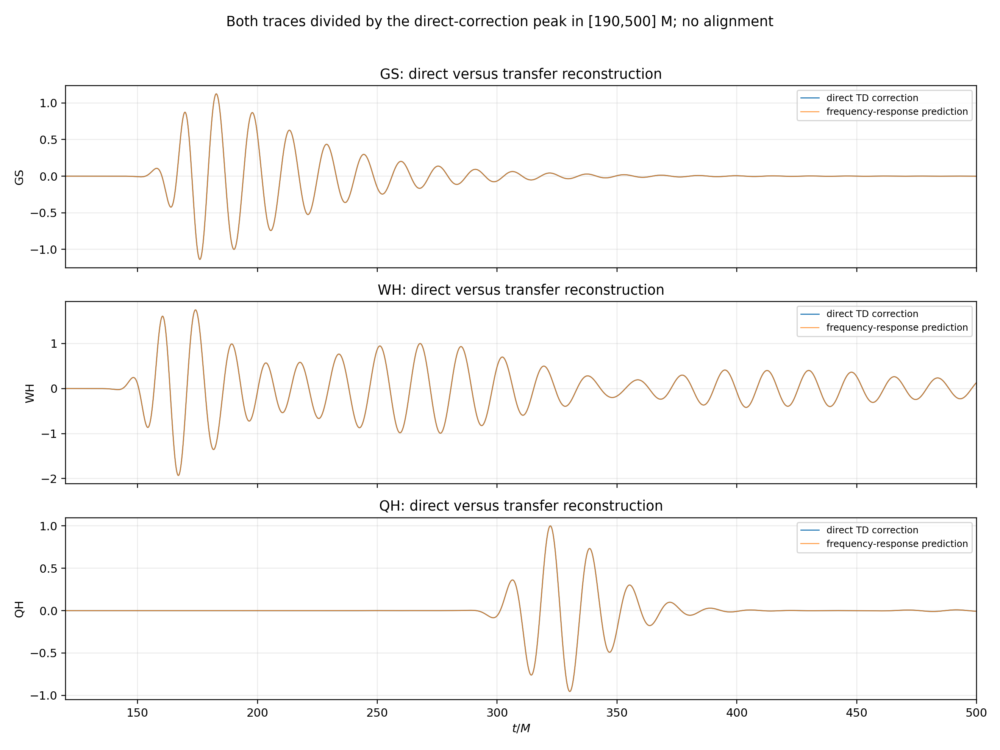

# Baseline: the validated equation code

`eco-waveform-final.ipynb` is the frozen notebook that implements the equations of every model in this
project and was validated before any later stage was built on it. It is not edited; later stages load
its declarations directly from this file and check its SHA-256
(`64e873da4b7afbb0f2abec91e4aa077a0493e998854582374af0a7a46c6513b9`) before using it.

## What the notebook does

All models are linear, nonrotating, axial (odd-parity) l = 2 gravitational perturbations, with
G = c = M = 1 and time dependence e^{-iωt}.

| Model | What is implemented | Independent check inside the notebook |
|---|---|---|
| Black hole (BH) | Schwarzschild, Regge–Wheeler equation | quasinormal modes from Leaver's continued fraction |
| Gravastar (GS) | thin-shell gravastar: de Sitter interior, Schwarzschild exterior, zero surface energy (Pani et al. 2009) | frequency-domain resonances against the time-domain evolution |
| Wormhole (WH) | thin-shell Schwarzschild wormhole with the axial throat matching of Yang, Xia and Miao (2025) | published quasinormal frequencies |
| Boson star (BS) | mini boson star (Macedo et al. 2013): equilibrium solved afresh, axial perturbation on the fixed background | published equilibrium table |
| Quantum horizon (QH) | Schwarzschild with the Oshita–Wang–Afshordi horizon reflectivity; a reflection prescription, not a spacetime | independent time-domain checks of the reflected signal |

The notebook evolves a Gaussian pulse with fourth-order finite differences and RK4 (`∂²Ψ/∂t² − ∂²Ψ/∂x² + VΨ = 0`),
extracts the signal at a fixed observer, and then:

* checks the BH against Leaver's quasinormal frequencies, and the time steps, grid spacing and
  boundaries by convergence and contamination tests;
* reconstructs each ECO signal a second way, from the BH signal and the frequency-dependent reflection
  of the ECO, and compares the two without any fitting;
* computes complex modes (poles) of each model by root finding, not from FFT peaks;
* measures BH-subtracted residuals, spectra, energy flux and echo-time estimators, and classifies the
  late-time response from explicit diagnostics.

Its sections, in order: physical models; architecture; the common evolution and extraction;
Schwarzschild benchmark; gravastar; boson star; wormhole; quantum horizon; waveform, phase-delay and
echo-time uncertainty; additional complex modes; transfer reconstruction; BH-subtracted residuals and
mismatch; parameter scan; resolution and time-step convergence; structured outputs; interpretation.

## Main results

* All 80 required validation checks pass (`eco_outputs_final/validation_summary.csv`), together with
  13 limiting-case checks, 9 independently regenerated comparisons, 20 controlled-geometry checks and
  408 replay checks; see `VALIDATION.md`.
* BH quasinormal frequencies (n = 0, 1, 2) agree with Leaver's values to 1.6e-8 (relative).
* The transfer reconstruction reproduces the directly evolved ECO signal without any fitted time,
  amplitude or phase: relative error in the late window 3.2e-4 (GS), 6.4e-7 (WH), 1.41e-3 (QH), against a
  limit of 1e-2. The figure below shows the two signals on top of each other.
* No model shows a clean echo train in this experiment: GS, WH and QH are trapped resonances, BS is
  inconclusive, and the BH has none.



## Files

| Path | Content |
|---|---|
| `eco-waveform-final.ipynb` | the frozen notebook (code and explanations; it stores no outputs) |
| `eco_outputs_final/` | everything the notebook writes: figures (`.png`), tables (`.csv`), waveforms and validation data (`.h5`, `.npz`) |
| `VALIDATION.md` | the validation record written when the notebook was frozen |
| `requirements.txt` | the package versions of the validated run |

## How to view it

Open `eco-waveform-final.ipynb` on GitHub to read the code and the explanations. The notebook was frozen
without stored outputs, so its figures and tables are the files in `eco_outputs_final/`, which open
directly on GitHub as well. Useful starting points: `validation_summary.csv`, `schwarzschild_qnms.csv`,
`selected_complex_modes_all_models.csv`, `transfer_vs_direct_waveforms.png`,
`unified_eco_reflection_response.png` and `all_models_complex_modes.png`.

## How to run it

The notebook needs no downloaded data. Either upload it to Kaggle and use Run All on a CPU session, or run
it locally (the validated run used Python 3.11.9 and took about 70 minutes):

```
cd baseline
pip install -r requirements.txt notebook
jupyter nbconvert --to notebook --execute eco-waveform-final.ipynb --output executed.ipynb --ExecutePreprocessor.timeout=-1
```

It writes its outputs to `eco_outputs_final/` in the folder it runs from (on Kaggle, to
`/kaggle/working/eco_outputs_final`), so running it here replaces the committed copy. To keep the
committed outputs for comparison, run it in a copy of this folder.

## Scope

Linear, nonrotating, axial perturbations only. The boson-star perturbation is a fixed-background axial
test field, not a coupled scalar–metric perturbation, and the quantum-horizon model is a
phenomenological boundary prescription, not a spacetime. The validation is evidence for these models in
the tested parameter range, not for a full merger waveform.
